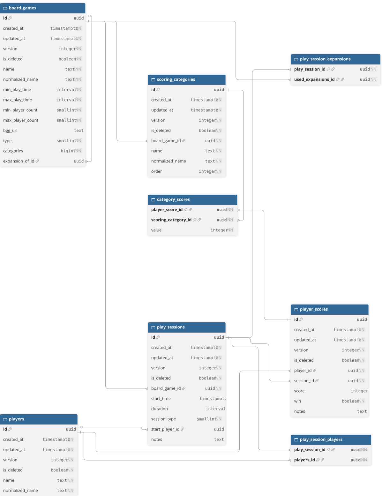

# BoardGameTracker

## About

Board game collection and session tracker application

## Planned features

- Organize board game collection
- Keep track of game session
- Generate statistics
- Board game recommendation based on time and player count
- BoardGameGeek integration
- Custom scoring by board game
- User login
- Frontend

## Entity relationships



## Test

From src directory run:

```bash
dotnet test
```

Or

```bash
bash run_tests.sh
```

### Coverage report

To generate coverage report with html output run:

```bash
bash run_tests.sh -c true
```

The generated html report can be found at: [index.html](src/coveragereport/index.html)

## Docker

### Dockerize

From main directory run:

```bash
docker build -t board_game_tracker_api -f docker/Dockerfile .
```

### Run dockerized application

```bash
docker run \
	--name board_game_tracker \
	-e DatabaseType=IN_MEMORY \
	-p 8080:8080 \
	-d board_game_tracker_api
```

Swagger can be accessed with ASPNETCORE_ENVIRONMENT=Development set
